# SaaS Auth

SaaS Auth provides shared identity and access control for an enterprise internal app platform where employees discover and open business apps in one place, so the platform can verify who is making each request and which roles they hold in the target app.

English · [简体中文](README.zh-CN.md)

Consider a monthly reporting app. An operator publishes it through **Admin**, the platform’s management console. An employee finds it in **Portal**, the employee-facing app directory, and signs in through **Keycloak**, the identity provider. When the employee opens the app, Portal asks **Auth** (this repository) whether they have access. The reporting app uses the platform’s **SDK** (software development kit) to read the verified user and roles and decide which reports they can see.

| If you want to… | Start here |
| --- | --- |
| Run Auth independently | [Local setup](#local-setup) |
| Integrate a business app | [Architecture](#architecture) · [Connect an app](#connect-an-app) |
| Configure roles, approve access or diagnose a denial | [Roles and approvals](#roles-and-approvals) · [API reference](#api-reference) |
| Change the service or deploy it | [Database](#database) · [Source map](#source-map) · [Development and deployment](#development-and-deployment) |

## Architecture



- **Keycloak authenticates the employee.** It handles registration, passwords, recovery and OpenID Connect (OIDC) sign-in. New users can sign in immediately after registration. Auth reports their email as unverified until Keycloak verifies it. Password recovery still uses email. Auth checks the token signature against the issuer’s public keys and uses token introspection to verify the upstream session.
- **Auth decides app access.** It maps an external identity to a stable platform user ID using the pair `(issuer, subject)`. It owns local sessions, app role definitions, direct grants, access requests and audit records. Each grant applies to one user and one app. The current model has no tenants or memberships.
- **Admin manages the app lifecycle.** It owns app registration, deployments and publication. Publication makes an app eligible for discovery. Its authenticated console server calls Auth when an operator grants access or reviews a request.
- **Portal enforces access at the entry point.** It manages the browser session and checks app permission when proxying protected requests. Each business app owns its data and interprets its roles, including which records a user can read, share or edit.

## Local setup

Run these commands from this repository with Python 3.11+, uv and Docker Compose. CI uses uv 0.11.7. This setup starts Auth and its dependencies and works independently of the other platform repositories.

```sh
uv sync --frozen
uv run python scripts/prepare_local.py   # First run only: generate credentials and realm
docker compose up --build -d --wait
curl --fail http://127.0.0.1:58000/health/ready
```

Expect `{"status":"ready"}`. Readiness checks database connectivity and the installed migration revision. Sign-in also depends on Keycloak. Explore the running API in [local Swagger UI](http://127.0.0.1:58000/docs).

| Compose service | Address or lifecycle | Responsibility |
| --- | --- | --- |
| `postgres` | Host `127.0.0.1:55433` | PostgreSQL 17, persisted in the `auth-db` volume |
| `migrate` | Runs once after PostgreSQL becomes healthy | Applies `alembic upgrade head` before the API and worker start |
| `auth` | `http://127.0.0.1:58000` | FastAPI user and operator endpoints |
| `keycloak` | Host `http://127.0.0.1:58080` | Imports a development realm. The issuer inside Compose is `http://keycloak:8080/realms/saas-local` |
| `worker` | Background process | Retries outstanding upstream session revocations |

The preparation script writes random credentials to the Git-ignored `.env` file and the realm configuration and local test certificates to `.local/`. Reuse these files on subsequent starts and skip the preparation step. To exercise the private operator API before creating any users, run this read-only call. A fresh database returns an empty `items` list.

```sh
. ./.env
AUTH=http://127.0.0.1:58000
curl --fail "$AUTH/v1/operator/users" \
  -H "X-Auth-Operator-Key: $SAAS_APP_OPERATOR_KEY" \
  -H 'X-Auth-Operator-Actor: local-dev'
```

For startup failures, inspect `docker compose ps -a` and `docker compose logs migrate auth keycloak worker`. Stop the stack with `docker compose down` to keep the Auth database volume. The Compose Keycloak uses temporary development storage. Its credentials and HTTP settings are for local use.

### Local Keycloak administrator

On the first start with an empty Keycloak database, Compose creates a temporary administrator in the `master` realm. The initial username is `local-admin` and the password is `local-keycloak-admin`. Open the [local Keycloak Admin Console](http://127.0.0.1:58080/admin/) and select `saas-local` after signing in. These published credentials are for local development only.

For a fresh local Kubernetes installation, pass `--set keycloak.localBootstrapAdmin.enabled=true` to the `saas-infrastructure` Helm release in the `saas-admin` repository to use the same account. An existing Keycloak database requires the server’s offline `bootstrap-admin` recovery command.

## Connect an app

Register the reporting app in the management console and note its UUID. An operator defines roles for that UUID in Auth. For example, the app might recognize a `reader` role. Each app defines its own role keys and their business meaning.



For the following server-side calls, set `APP_ID` to the app UUID and `ACCESS_TOKEN` to a user access token whose audience includes `saas-auth`. In the platform, Portal obtains it through the OIDC authorization code flow with PKCE. To exercise real login from this repository alone, the [Keycloak integration tests](tests/test_user_keycloak.py) demonstrate the callback, code exchange and token exchange.

```sh
curl --fail "$AUTH/v1/me" -H "Authorization: Bearer $ACCESS_TOKEN"
curl --fail "$AUTH/v1/apps/$APP_ID/permissions" \
  -H "Authorization: Bearer $ACCESS_TOKEN"
```

The first valid user request creates the identity mapping and local session. Use `user.id` from `/me` as the platform identifier. A signed-in user who has never received a grant gets **HTTP 200** from the permissions endpoint with `allowed: false`, `roles: []` and `authorizationVersion: 0`. Check `allowed` when deciding access. A revoked grant can still have a positive version.

## Roles and approvals

For a **new app with no role configuration**, define `reader`, then submit a request as the signed-in employee. To edit an existing app, first GET the operator roles endpoint and PUT the full desired list with the returned `version`. Keep operator credentials on a trusted server. In production, the console supplies the verified operator identity for the audit log.

```sh
ROLE_OP=$(uuidgen)
curl --fail -X PUT "$AUTH/v1/operator/apps/$APP_ID/roles" \
  -H "X-Auth-Operator-Key: $SAAS_APP_OPERATOR_KEY" \
  -H 'X-Auth-Operator-Actor: local-dev' -H "Idempotency-Key: $ROLE_OP" \
  -H 'Content-Type: application/json' \
  -d '{"version":0,"roles":[{"key":"reader","name":"Report reader","active":true}]}'

REQUEST_OP=$(uuidgen)
curl --fail -X POST "$AUTH/v1/apps/$APP_ID/requests" \
  -H "Authorization: Bearer $ACCESS_TOKEN" -H "Idempotency-Key: $REQUEST_OP" \
  -H 'Content-Type: application/json' \
  -d '{"roles":["reader"],"reason":"Read monthly reports"}'
```

Set `REQUEST_ID` to the `id` from the submission response. Approve as the operator, then repeat the employee’s permissions call. Expect `allowed: true` and `reader` in `roles`.

```sh
REVIEW_OP=$(uuidgen)
curl --fail -X PUT "$AUTH/v1/operator/requests/$REQUEST_ID" \
  -H "X-Auth-Operator-Key: $SAAS_APP_OPERATOR_KEY" \
  -H 'X-Auth-Operator-Actor: local-dev' -H "Idempotency-Key: $REVIEW_OP" \
  -H 'Content-Type: application/json' \
  -d '{"decision":"approved","comment":"Reporting access confirmed"}'
```



Each user can have one pending request per app. Approval updates the request, grant and audit history in one transaction. Rejection preserves the request and allows a new submission. Removing or disabling a role strips it from active grants and disables any grant left without roles. If a pending request contains a role that is no longer active, the reviewer can reject it with an explanation. Reintroducing the key leaves previously disabled access revoked.

## API reference

All paths below start with `/v1`. User routes require a bearer token. Every operator route requires both `X-Auth-Operator-Key` and `X-Auth-Operator-Actor`. Writes require a 16–128 character `Idempotency-Key`. Use a fresh key for a new operation and keep the original key and payload for retries.

| Caller | Method and path | Purpose |
| --- | --- | --- |
| User | `GET /me` | Read the current platform user |
| User | `GET /apps/{appId}/permissions` | Evaluate access and return the grant version |
| User | `GET /apps/{appId}/roles` | List active roles available to request |
| User | `GET /apps/{appId}/requests` · `POST /apps/{appId}/requests` | Read the user’s latest 20 requests or submit roles and an optional reason |
| User | `DELETE /sessions/current` | Sign out the current session, returning 204 or 202 |
| Operator | `GET /operator/users` | Page through mapped platform users |
| Operator | `GET` or `PUT /operator/apps/{appId}/roles` | Read or replace up to 100 role definitions using the current version |
| Operator | `GET` or `PUT /operator/apps/{appId}/grants` | List grants or set one directly with `{userId, roles, enabled}` |
| Operator | `GET /operator/requests` | Page through the review queue with an optional `status` filter |
| Operator | `PUT /operator/requests/{requestId}` | Approve or reject with a nonempty comment |

For paginated lists, pass the returned `nextCursor` as the next `cursor`. Error bodies include `code`, `message` and `requestId`. The response also includes `X-Request-ID`. For 401, check credentials and session validity. For 409, use the error code to identify a role, version, pending-request or idempotency conflict. For 422, check inputs. For 503, check the database and identity provider. See the [OpenAPI contract](contracts/openapi.json) and [current user example](contracts/examples/current-user.json).

### What the logout response means



Logout requires an established local session matching the verified identity. Ordinary user requests check the local revocation flag, a 30-minute idle timeout and an eight-hour maximum session lifetime. After a 202, local logout is effective. Inspect the worker and the attempt count, lease and completion time in `session_tasks` to follow upstream delivery.

## Database

The default PostgreSQL schema (normally `public`) contains twelve application tables and Alembic’s revision table. The diagrams show physical columns and PostgreSQL types. Blue arrows run from each foreign key to its referenced column. All seven use PostgreSQL’s default ON DELETE NO ACTION. The access diagram repeats only the user primary key. The app UUID also identifies a registration in Admin’s separate database. Auth checks role keys against the app’s definitions when granting access.







<details>
<summary>Foreign key overview</summary>



</details>

| Table | Primary key | Other columns and purpose |
| --- | --- | --- |
| `users` | `id` | `display_name, email, email_verified, status`. Stable platform identity. Verified user requests refresh profile data. |
| `external_identities` | `issuer, subject` | `user_id` references users. Each issuer/subject pair maps to one platform user. |
| `service_principals` | `id` | `issuer, subject, client_id, enabled`. Registered machine identities are excluded from human user mapping. Both issuer/subject and issuer/client ID are unique pairs. |
| `auth_sessions` | `issuer, sid` | `user_id, created_at, last_seen_at, revoked_at`. Associates the upstream session with a local user and tracks activity and revocation. |
| `app_role_sets` | `app_id` | `version`. Detects concurrent changes to the app’s role definitions. |
| `app_roles` | `app_id, key` | `name, description, active`. A role has a stable app-scoped key and an editable display name. |
| `user_app_grants` | `user_id, app_id` | `roles text[], enabled, version`. One direct grant per user/app. Its version is independent of the role set version. |
| `app_access_requests` | `id` | `user_id, app_id, roles text[], reason, status, reviewer, comment, created_at, reviewed_at`. Stores review history. A partial unique index enforces one pending request per user/app. |
| `user_idempotency` | `user_id, method, route, key` | `request_hash, status, body, etag, created_at`. Logout uses these records to recognize retries for the same session. |
| `app_operations` | `key` | `hash, body`. Stores the request digest and JSONB result for replaying app-related writes. |
| `platform_audit` | `id` | `actor, action, resource_id, request_id, details, occurred_at`. Identifies the actor, action and affected resource, with JSONB details. |
| `session_tasks` | `id` | `resource_id, ciphertext, available_at, lease_id, lease_until, attempts, completed_at`. Unique resource identifier. The worker claims incomplete tasks as they become due. |
| `alembic_version` | `version_num` | Records the installed migration revision for the readiness check. |

**Migration history.** Revision 001 created the foundation. Revision 002 introduced user sessions and invitations. Revision 003 preserved users and sessions, moved eleven historical tables (including tenants and memberships) into the private `legacy_tenancy` schema and created empty direct grants. Operators must review and grant intended access after that upgrade. Revision 004 imported role keys from existing explicit grants and added the access request table. Each business app retains its own data. For exact SQL types, constraints, indexes and data transformations, see the [ORM models](src/saas_auth/db/models.py) and [migration sources](src/saas_auth/alembic/versions/).

## Source map

| Change | Entry point |
| --- | --- |
| HTTP routes, request/response models, dependencies and health checks | [api/](src/saas_auth/api/) |
| JWT verification, signing keys, token introspection and upstream revocation | [identity/](src/saas_auth/identity/) |
| User mapping, sessions, permission checks and direct grants | [services/users.py](src/saas_auth/services/users.py) |
| Role configuration, approvals, locking, audit and idempotency | [services/access.py](src/saas_auth/services/access.py) · [services/operations.py](src/saas_auth/services/operations.py) |
| Persistence, migrations, task delivery and operator commands | [db/](src/saas_auth/db/) · [alembic/](src/saas_auth/alembic/) · [worker/revocation.py](src/saas_auth/worker/revocation.py) · [cli.py](src/saas_auth/cli.py) |
| Local services, credentials and deployment | [compose.yaml](compose.yaml) · [scripts/prepare_local.py](scripts/prepare_local.py) · [Helm chart](deploy/charts/saas-auth/) |

## Development and deployment

### Configuration

Compose supplies the following environment variables. To run the API on the host, set them explicitly. The issuer must match the token claim and be reachable from the API. After applying migrations, start the API with `uv run uvicorn saas_auth.api:create_app --factory --port 8000`. See [Settings](src/saas_auth/config/settings.py).

| Variable | Purpose |
| --- | --- |
| `SAAS_DATABASE_URL` | PostgreSQL connection string shared by the API, worker and migrations |
| `SAAS_OIDC_ISSUER`, `SAAS_OIDC_AUDIENCE` | Trusted realm URL and token audience (default `saas-auth`). Use HTTPS in production. Supported local hosts can use HTTP with `SAAS_ALLOW_INSECURE_LOCAL=true`. |
| `SAAS_USER_CLIENTS` | Comma-separated trusted user client IDs matched against the token’s `azp` claim. Local value is `saas-portal`. |
| `SAAS_INTROSPECTION_CLIENT`, `SAAS_INTROSPECTION_SECRET` | Client credentials used to verify the token with Keycloak |
| `SAAS_TASK_KEY` | Fernet key shared by the API and worker for encrypting and decrypting revocation tasks |
| `SAAS_SESSION_WORKER_CLIENT`, `SAAS_SESSION_WORKER_SECRET` | Service account used for immediate upstream revocation and worker retries |
| `SAAS_APP_OPERATOR_KEY` | Private operator credential of at least 32 random characters, held by Auth and the trusted Admin server |
| `SAAS_CURSOR_SECRET` | Required at startup, at least 32 characters. Current list endpoints accept UUID cursors. |

The CLI also supports direct grants. Run `uv run saas-auth grant-app --help` for arguments. Writes require `SAAS_ENABLE_BOOTSTRAP=true`, `SAAS_OPERATOR_ID` and an operation key. The worker command is `saas-auth private-tasks-worker`.

### Database and API changes

Set `SAAS_DATABASE_URL` to a development database and run:

```sh
uv run alembic upgrade head
uv run alembic current
uv run alembic history
uv run alembic check
```

For a schema change, update the ORM mappings and run `uv run alembic revision --autogenerate -m "Describe the schema change"`. Review constraints, data transformations and rollback steps. Concurrent upgrades share a PostgreSQL transaction lock. Rolling back across revisions 001–004 requires restoring a backup.

After changing an endpoint, run `uv run python scripts/generate_contracts.py` and review the generated OpenAPI alongside the implementation. Set `SAAS_TEST_DATABASE_URL` to a dedicated PostgreSQL database whose name ends in `_test`. Tests clear its data. Chart tests require Helm.

```sh
uv run mypy
uv run ruff check src tests scripts/prepare_local.py scripts/realm_users.py scripts/local_tls.py
uv run python scripts/validate_contracts.py
uv run pytest -q -m 'not keycloak'
```

Real Keycloak tests also use a separate HTTPS realm, a local certificate, an SMTP capture server and test client credentials. The [CI workflow](.github/workflows/validate.yml) contains the setup commands. For more design detail, see the [user/app model](docs/USER-APP-PLATFORM.md) and [access request design](docs/APP-ACCESS-REQUESTS.md). Older documents referring to tenant memberships or the `bootstrap-tenant` command describe the pre-migration model.

### Kubernetes

For a new deployment, use `deploy/scripts/prepare.py` in the `saas-admin` repository to prepare the shared Secrets. The `saas-auth` and `saas-worker` Secrets supply the OIDC settings. If your existing deployment supplies those settings through Helm values, continue passing that values file. Set the API and worker to the same immutable Auth image digest. Install Auth before the Admin/Portal platform release in the same namespace. Existing installations where the platform release owns Auth resources require a Helm ownership migration before switching releases.

```sh
AUTH_IMAGE='REGISTRY/saas-auth@sha256:IMAGE_DIGEST'
helm upgrade --install saas-auth deploy/charts/saas-auth \
  --namespace saas-stage \
  --set-string "workloads.auth.image=$AUTH_IMAGE" \
  --set-string "workloads.worker.image=$AUTH_IMAGE" \
  --atomic --wait --timeout 10m
helm test saas-auth --namespace saas-stage --logs
```

The chart includes the API, worker, migration hook, private TLS Service, NetworkPolicy and a readiness smoke test. Use `/health/live` for liveness and `/health/ready` for database and migration readiness.
