# SaaS Auth

SaaS Auth 为企业内部应用平台提供统一的身份与授权服务，让员工可以从同一个入口发现和打开业务应用，也让平台能在每次访问时确认员工身份及其在目标应用中的角色。

[English](README.md) · 简体中文

以月度报表为例：运营人员在 **Admin（管理控制台）** 发布报表应用，员工从 **Portal（员工门户）** 找到它并通过 **Keycloak（登录服务）** 登录。员工打开报表时，门户向本仓库的 **Auth** 查询访问权。报表应用通过 **SDK（应用开发工具包）** 取得经过验证的用户和角色信息，再决定员工能查看哪些报表。授权以一个用户和一个应用为单位。

| 我想做什么 | 从哪里开始 |
| --- | --- |
| 在本机跑通服务，确认数据库可用 | [本地启动](#本地启动) |
| 给新应用接入登录和授权 | [平台边界](#平台边界) · [接入一个应用](#接入一个应用) |
| 配置角色、处理访问申请或排查权限 | [角色与审批](#角色与审批) · [API 速查](#api-速查) |
| 改接口、表结构或部署配置 | [数据库](#数据库) · [代码导航](#代码导航) · [开发与部署](#开发与部署) |

## 平台边界



- **Keycloak** 处理密码、注册、验证邮件、找回密码与 OIDC 登录。Auth 使用受信 issuer 的公钥验证访问令牌，再向 Keycloak 确认用户会话仍然有效。
- **Auth** 拥有平台用户、身份映射、会话、角色定义、授权、申请及审计。同一邮箱不能作为跨身份合并依据，身份键是 `(issuer, subject)`。
- **Admin** 拥有应用注册信息、部署和发布状态，并由已认证的控制台服务端调用 Auth 管理授权。应用出现在发现页，只说明它满足发布条件。
- **Portal** 持有浏览器会话，在代理受保护请求时检查应用访问权。**SDK 与业务应用**消费已验证的用户、应用及角色上下文。某用户能否编辑某条订单、哪些记录可共享，由业务应用实现。

## 本地启动

需要 Python 3.11+、uv、Docker Compose。CI 使用 uv 0.11.7。以下命令在仓库根目录执行。

```sh
uv sync --frozen
uv run python scripts/prepare_local.py   # 首次运行，生成本地凭据和 realm
docker compose up --build -d --wait
curl --fail http://127.0.0.1:58000/health/ready
```

预期得到 `{"status":"ready"}`。打开 [本地 Swagger UI](http://127.0.0.1:58000/docs) 查看接口。就绪探针检查数据库能否访问以及迁移版本是否等于服务内置的 head。登录链路还依赖 Keycloak。

| Compose 服务 | 地址或生命周期 | 职责 |
| --- | --- | --- |
| `postgres` | 宿主机 `127.0.0.1:55433` | PostgreSQL 17，数据保存在 `auth-db` 卷 |
| `migrate` | PostgreSQL 健康后运行一次 | 执行 `alembic upgrade head`，成功后退出 |
| `auth` | `http://127.0.0.1:58000` | FastAPI 用户、授权与操作员接口 |
| `keycloak` | 宿主机 `http://127.0.0.1:58080` | 导入开发 realm；容器内 issuer 为 `http://keycloak:8080/realms/saas-local` |
| `worker` | 后台进程 | 重试尚未完成的上游会话撤销任务 |

首次准备脚本将随机凭据写入已被 Git 忽略的 `.env`，realm 和本地测试证书写入 `.local/`。再次启动复用这些文件，跳过准备步骤。以下只读调用可验证操作员接口，无需启动 Portal 或先创建用户。新数据库返回空的 `items` 列表。

```sh
. ./.env
AUTH=http://127.0.0.1:58000
curl --fail "$AUTH/v1/operator/users" \
  -H "X-Auth-Operator-Key: $SAAS_APP_OPERATOR_KEY" \
  -H 'X-Auth-Operator-Actor: local-dev'
```

查看启动问题用 `docker compose ps -a` 和 `docker compose logs migrate auth keycloak worker`。日常停止用 `docker compose down`，保留 Auth 数据卷。Compose 的 Keycloak 使用临时开发存储，这套凭据和 HTTP 配置仅供本地使用。

## 接入一个应用

假设要接入一个报表应用。先在 Admin 注册应用并取得它的 UUID。操作员随后在 Auth 为同一 UUID 定义该应用认可的角色，例如 `reader`。平台没有预设应用角色，角色的业务含义由报表应用解释。



**在服务端验证接入。** 将 `APP_ID` 设为应用 UUID，`ACCESS_TOKEN` 设为 Portal 通过 OIDC 授权码和 PKCE 登录取得、受众包含 `saas-auth` 的用户访问令牌。前面的 Compose 仅启动 Auth 及其依赖。单仓验证真实登录时，可使用 [Keycloak 协议集成测试](tests/test_user_keycloak.py) 中的授权码、回调与 token exchange 示例。

```sh
curl --fail "$AUTH/v1/me" -H "Authorization: Bearer $ACCESS_TOKEN"
curl --fail "$AUTH/v1/apps/$APP_ID/permissions" \
  -H "Authorization: Bearer $ACCESS_TOKEN"
```

首次有效请求会创建用户映射和本地会话。使用 `/me` 返回的 `user.id` 引用平台用户。已登录但从未获授权的用户查询权限会得到 **HTTP 200**、`allowed: false`、`roles: []` 和 `authorizationVersion: 0`。已撤销的授权可以保留正数版本，因此调用方应读取 `allowed` 决定是否放行。

## 角色与审批

以下示例在本地为**尚未配置角色的新应用**定义 `reader`，再以已登录用户身份申请。已有配置先 GET 同一路径，保留仍需使用的角色，PUT 完整角色列表和当前 `version`。操作员凭据仅放在受信服务端，生产中的 actor 取自控制台验证过的操作员身份。

```sh
ROLE_OP=$(uuidgen)
curl --fail -X PUT "$AUTH/v1/operator/apps/$APP_ID/roles" \
  -H "X-Auth-Operator-Key: $SAAS_APP_OPERATOR_KEY" \
  -H 'X-Auth-Operator-Actor: local-dev' -H "Idempotency-Key: $ROLE_OP" \
  -H 'Content-Type: application/json' \
  -d '{"version":0,"roles":[{"key":"reader","name":"报表读者","active":true}]}'

REQUEST_OP=$(uuidgen)
curl --fail -X POST "$AUTH/v1/apps/$APP_ID/requests" \
  -H "Authorization: Bearer $ACCESS_TOKEN" -H "Idempotency-Key: $REQUEST_OP" \
  -H 'Content-Type: application/json' \
  -d '{"roles":["reader"],"reason":"查看月度报表"}'
```

将响应中的 `id` 设为 `REQUEST_ID`，由操作员审批。成功后再次查询用户的 `permissions`，应得到 `allowed: true` 且 `roles` 包含 `reader`。

```sh
REVIEW_OP=$(uuidgen)
curl --fail -X PUT "$AUTH/v1/operator/requests/$REQUEST_ID" \
  -H "X-Auth-Operator-Key: $SAAS_APP_OPERATOR_KEY" \
  -H 'X-Auth-Operator-Actor: local-dev' -H "Idempotency-Key: $REVIEW_OP" \
  -H 'Content-Type: application/json' \
  -d '{"decision":"approved","comment":"已核实报表访问需求"}'
```



每个用户对同一应用同时最多有一条待审申请。批准会在一个事务内更新申请、授权和审计；拒绝保留历史，用户可另行提交。角色变更会从有效授权中剔除失效的 key，角色清空时禁用授权。待审角色已失效时，审批人应拒绝并说明原因。重新加入同名角色不会恢复已禁用的访问权。

## API 速查

路径均以 `/v1` 为前缀。用户接口使用 Bearer；所有 `/operator` 接口均需 `X-Auth-Operator-Key` 和 `X-Auth-Operator-Actor`。以下写操作均要求 16–128 字符的 `Idempotency-Key`：每次新操作使用新键，网络重试沿用原键和原请求内容。

| 调用方 | 方法和路径 | 用途 |
| --- | --- | --- |
| 用户 | `GET /me` | 读取当前平台用户 |
| 用户 | `GET /apps/{appId}/permissions` | 在线判断授权及其版本 |
| 用户 | `GET /apps/{appId}/roles` | 查询可申请的有效角色 |
| 用户 | `GET /apps/{appId}/requests` · `POST /apps/{appId}/requests` | 最近 20 条本人申请；提交角色和可选理由 |
| 用户 | `DELETE /sessions/current` | 注销当前会话，返回 204 或 202 |
| 操作员 | `GET /operator/users` | 分页查询已经映射的平台用户 |
| 操作员 | `GET /operator/apps/{appId}/roles` · `PUT` 同路径 | 读取或按版本替换角色定义，最多 100 个 |
| 操作员 | `GET /operator/apps/{appId}/grants` · `PUT` 同路径 | 查询或直接设置授权；写入体为 `{userId, roles, enabled}` |
| 操作员 | `GET /operator/requests` | 分页审批队列，支持 `status` 筛选 |
| 操作员 | `PUT /operator/requests/{requestId}` | 批准或拒绝，必须填写非空评论 |

列表分页将返回的 `nextCursor` 作为下一次的 `cursor`。错误体含 `code`、`message`、`requestId`，响应头也有 `X-Request-ID`。401 时检查凭据和会话；409 时先查看错误码并核对角色、版本、待审状态或幂等键；422 时核对参数；503 时检查数据库和身份提供方。字段类型与响应示例见 [OpenAPI 契约](contracts/openapi.json) 和 [当前用户示例](contracts/examples/current-user.json)。

### 注销为何有两种成功响应



Auth 只允许注销已经建立且与身份匹配的本地会话。普通用户请求还检查本地撤销标记、30 分钟空闲上限和 8 小时总时长。收到 202 时本地撤销已经生效；排查上游进度可查看 Worker 与 `session_tasks` 的尝试次数、租约和完成时间。

## 数据库

PostgreSQL 默认 schema（通常为 `public`）包含 12 张运行时业务表和 Alembic 版本表。下图列出各表的物理字段和 PostgreSQL 类型。蓝色箭头从外键字段指向被引用字段。七条外键均使用 PostgreSQL 默认的 ON DELETE NO ACTION。授权图中再次出现的 users 仅展示主键。跨服务的应用 UUID 和角色 key 数组由服务逻辑校验，Auth 库里没有 Admin 的应用注册表。







<details>
<summary>外键关系总览</summary>



</details>

| 表 | 主键 | 其余字段与用途 |
| --- | --- | --- |
| `users` | `id` | `display_name, email, email_verified, status`。稳定的平台用户 ID；验证用户请求时刷新资料 |
| `external_identities` | `issuer, subject` | `user_id` → users。同一签发方的同一 subject 唯一映射到平台用户 |
| `service_principals` | `id` | `issuer, subject, client_id, enabled`。已登记机器身份；用户映射会检查并排除这些主体。issuer 与 subject、issuer 与 client_id 分别唯一 |
| `auth_sessions` | `issuer, sid` | `user_id, created_at, last_seen_at, revoked_at`。记录上游会话对应的本地用户、活跃时间和撤销状态 |
| `app_role_sets` | `app_id` | `version`。应用角色集合的配置版本，用于防止并发编辑覆盖 |
| `app_roles` | `app_id, key` | `name, description, active`。角色 key 在同一应用内唯一，显示名称可调整 |
| `user_app_grants` | `user_id, app_id` | `roles text[], enabled, version`。每个用户/应用一行；这里的版本用于权限响应，与角色配置版本独立 |
| `app_access_requests` | `id` | `user_id, app_id, roles text[], reason, status, reviewer, comment, created_at, reviewed_at`。保留申请和审批历史；部分唯一索引限制每对用户/应用只有一条 pending |
| `user_idempotency` | `user_id, method, route, key` | `request_hash, status, body, etag, created_at`。记录用户操作，当前注销路径用它识别同一会话的重试 |
| `app_operations` | `key` | `hash, body`。保存应用相关写入的请求摘要和 JSONB 结果，供重复请求回放 |
| `platform_audit` | `id` | `actor, action, resource_id, request_id, details, occurred_at`。记录谁对哪个资源做了什么，详情为 JSONB |
| `session_tasks` | `id` | `resource_id, ciphertext, available_at, lease_id, lease_until, attempts, completed_at`。资源标识唯一；Worker 按可执行时间领取未完成任务 |
| `alembic_version` | `version_num` | Alembic 管理当前数据库修订号，就绪检查将其与随包发布的 head 比对 |

**历史 schema。** 001 建立基础表，002 引入用户会话与邀请，003 将原租户、成员、角色分配、邀请等 11 张旧表迁至私有 `legacy_tenancy`，保留用户和会话，并建立空的直接授权表。升级后需要逐项确认并授予访问权。004 从已有显式授权导入角色 key 并加入审批表。历史表只作归档；子应用业务数据由各应用管理。精确 SQL 类型、索引、检查约束及数据搬迁见 [ORM 映射](src/saas_auth/db/models.py) 和 [迁移源码](src/saas_auth/alembic/versions/)。

## 代码导航

| 修改目标 | 入口 |
| --- | --- |
| HTTP 路由、输入输出、依赖注入和健康检查 | [api/](src/saas_auth/api/) |
| JWT 验证、JWKS、在线内省和 Keycloak 会话撤销 | [identity/](src/saas_auth/identity/) |
| 用户映射、会话、权限计算、直接授权 | [services/users.py](src/saas_auth/services/users.py) |
| 角色配置、申请与审批事务；公共锁、审计与幂等 | [services/access.py](src/saas_auth/services/access.py) · [services/operations.py](src/saas_auth/services/operations.py) |
| 持久化、迁移、撤销任务与运维命令 | [db/](src/saas_auth/db/) · [alembic/](src/saas_auth/alembic/) · [worker/revocation.py](src/saas_auth/worker/revocation.py) · [cli.py](src/saas_auth/cli.py) |
| 本地依赖、凭据生成与部署 | [compose.yaml](compose.yaml) · [scripts/prepare_local.py](scripts/prepare_local.py) · [Helm chart](deploy/charts/saas-auth/) |

## 开发与部署

### 配置

Compose 注入下列环境变量。宿主机单独运行 API 时要显式提供配置，issuer 的值须与令牌声明一致，其地址也须能从 API 访问。配置完成并迁移后可执行 `uv run uvicorn saas_auth.api:create_app --factory --port 8000`。完整约束见 [Settings](src/saas_auth/config/settings.py)。

| 变量 | 配置用途 |
| --- | --- |
| `SAAS_DATABASE_URL` | PostgreSQL 连接串，API、Worker、迁移连接同一 Auth 库 |
| `SAAS_OIDC_ISSUER`, `SAAS_OIDC_AUDIENCE` | 可信 realm 地址、访问令牌受众（默认 `saas-auth`）。生产使用 HTTPS；本地受限主机可显式设 `SAAS_ALLOW_INSECURE_LOCAL=true` |
| `SAAS_USER_CLIENTS` | 逗号分隔的可信用户客户端 ID，对应令牌的 `azp`；本地为 `saas-portal` |
| `SAAS_INTROSPECTION_CLIENT`, `SAAS_INTROSPECTION_SECRET` | Auth 调用 Keycloak 内省接口的凭据 |
| `SAAS_TASK_KEY` | 有效 Fernet 密钥，API 与 Worker 共享，用于加解密会话撤销任务 |
| `SAAS_SESSION_WORKER_CLIENT`, `SAAS_SESSION_WORKER_SECRET` | API 同步撤销与 Worker 重试调用 Keycloak 所用服务账号 |
| `SAAS_APP_OPERATOR_KEY` | 操作员接口共享密钥，至少 32 个随机字符；仅注入 Auth 和受信 Admin 服务端 |
| `SAAS_CURSOR_SECRET` | 启动时必填，至少 32 个字符；当前列表接口接受 UUID 游标 |

CLI 也可直接维护授权：运行 `uv run saas-auth grant-app --help` 查看参数。写操作要求 `SAAS_ENABLE_BOOTSTRAP=true`、`SAAS_OPERATOR_ID` 和操作幂等键。后台任务入口为 `saas-auth private-tasks-worker`。

### 修改数据库和 API

在环境中设置指向开发库的 `SAAS_DATABASE_URL` 后执行：

```sh
uv run alembic upgrade head
uv run alembic current
uv run alembic history
uv run alembic check
```

变更表结构时先改 ORM，再运行 `uv run alembic revision --autogenerate -m "Describe the schema change"`，人工审查约束、数据转换和回滚步骤。并发升级使用 PostgreSQL 事务锁。001–004 不支持自动 downgrade，跨这些修订回退需要恢复备份。

变更接口后运行 `uv run python scripts/generate_contracts.py`，将生成的 OpenAPI 与实现一起评审。测试会清空数据，必须给 `SAAS_TEST_DATABASE_URL` 设置专用、库名以 `_test` 结尾的 PostgreSQL 数据库。Helm 测试需要本机安装 Helm。

```sh
uv run mypy
uv run ruff check src tests scripts/prepare_local.py scripts/realm_users.py scripts/local_tls.py
uv run python scripts/validate_contracts.py
uv run pytest -q -m 'not keycloak'
```

真实 Keycloak 测试还需要独立的 HTTPS realm、本地证书、SMTP 捕获器以及测试客户端凭据。完整环境变量和启动命令以 [CI 工作流](.github/workflows/validate.yml) 为准。当前架构设计见[用户与应用模型](docs/USER-APP-PLATFORM.md)和[访问申请设计](docs/APP-ACCESS-REQUESTS.md)；旧文档中的 tenant、membership 和 bootstrap-tenant 命令属于迁移前版本。

### Kubernetes

先通过管理控制台的独立仓库 `saas-admin` 中的 `deploy/scripts/prepare.py` 准备共享 Secret 与 `auth-values.json`。API 和 Worker 使用同一不可变镜像摘要。在同一命名空间先安装 Auth，再安装 Admin/Portal 平台 release。已有平台 release 管理 Auth 资源时，切换前需要迁移 Helm 资源所有权。

```sh
helm upgrade --install saas-auth deploy/charts/saas-auth \
  --namespace saas-stage -f /secure/path/auth-values.json \
  --atomic --wait --timeout 10m
helm test saas-auth --namespace saas-stage --logs
```

Chart 包含 API、Worker、迁移 hook、私有 TLS Service、NetworkPolicy 和就绪烟测。探活路径为 `/health/live`，迁移与数据库就绪路径为 `/health/ready`。
